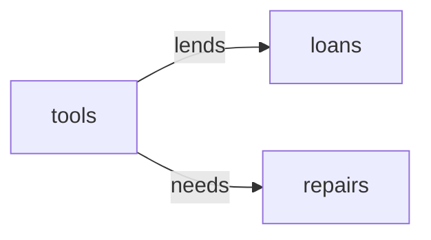

# Demo Handmade: Semantic Model

## 1. Overview

A module built by hand in the UI.

## 2. Entity summary

| # | Table name | Singular label | Purpose |
|---|---|---|---|
| 1 | `tools` | Tool | A tool in the workshop. |
| 2 | `loans` | Loan | A tool lent to someone. |
| 3 | `repairs` | Repair | A repair of a tool. |

### Entity-relationship diagram

## 3. Entities

### 3.1 `tools` - Tool

**Plural label:** Tools
**Label column:** `tool_name`
**Audit log:** no
**View permission:** demo-handmade:read
**Edit permission:** demo-handmade:manage
**Catalog entity code:** `tools`
**Entity type:** catalog
**Description:** A tool in the workshop.

**Fields**

| Field name | Format | Required | Label | Description | Reference / Notes |
|---|---|---|---|---|---|
| `tool_name` | `string` | yes | Tool Name | | `label_column` |

**Relationships**

- A `tools` record may have many `loans` (1:N, via `loans.tool_id`).
- A `tools` record may have many `repairs` (1:N, via `repairs.tool_id`).

### 3.2 `loans` - Loan

**Plural label:** Loans
**Label column:** `loan_title`
**Audit log:** no
**View permission:** demo-handmade:read
**Edit permission:** demo-handmade:lend
**Catalog entity code:** `loans`
**Entity type:** operational_record
**Description:** A tool lent to someone.

**Fields**

| Field name | Format | Required | Label | Description | Reference / Notes |
|---|---|---|---|---|---|
| `loan_title` | `string` | yes | Loan Title | | `label_column` |
| `tool_id` | `reference` | yes | Tool | | → `tools` (N:1), relationship_label: "lends" |

**Relationships**

- A `loans` record belongs to one `tools` via `tool_id` (N:1, required, restrict on delete).

### 3.3 `repairs` - Repair

**Plural label:** Repairs
**Label column:** `repair_title`
**Audit log:** no
**View permission:** demo-handmade:read
**Edit permission:** demo-handmade:write_repairs
**Catalog entity code:** `repairs`
**Entity type:** operational_record
**Description:** A repair of a tool.

**Fields**

| Field name | Format | Required | Label | Description | Reference / Notes |
|---|---|---|---|---|---|
| `repair_title` | `string` | yes | Repair Title | | `label_column` |
| `tool_id` | `reference` | yes | Tool | | → `tools` (N:1), relationship_label: "needs" |

**Relationships**

- A `repairs` record belongs to one `tools` via `tool_id` (N:1, required, restrict on delete).

---

## 4. Relationship summary

| FK table | FK field | References | Cardinality | Kind | fk_format | Delete behavior |
|---|---|---|---|---|---|---|
| `loans` | `tool_id` | `tools` | N:1 | reference | reference | restrict |
| `repairs` | `tool_id` | `tools` | N:1 | reference | reference | restrict |

## 5. Enumerations

_(none: no enum fields in this module)_

## 6. Cross-model relationship suggestions

_(none: live extraction is reverse-engineering; every cross-module FK already exists as a §3 reference)_

### Outbound handoffs

_(none: not extracted from live state by semantius-optimizer; carried from the blueprint when one exists)_

### Inbound handoffs

_(none: not extracted from live state by semantius-optimizer; carried from the blueprint when one exists)_

## 7. Open questions

### 7.1 🔴 Decisions needed (blockers)

_(none: reverse-engineered from a live module; nothing blocks redeployment)_

### 7.2 🟡 Future considerations (deferred scope)

_(none: reverse-engineered from a live module)_

## 8.1 Permissions catalog

| permission | tier | description | included in `:admin`? | high risk? |
| --- | --- | --- | --- | --- |
| `demo-handmade:read` | baseline-read | Read the workshop. | ✓ | - |
| `demo-handmade:manage` | baseline-manage | Run the workshop. | ✓ | - |
| `demo-handmade:lend` | narrow | Lend tools. | ✓ | - |
| `demo-handmade:write_repairs` | narrow | Record repairs. | ✓ | - |

## 8.2 Business rules

_(none: access_scope is custom, so no permission-gated business rules are authored)_

## 9. Governance

### 9.1 `DEMO-HANDMADE`

**Baseline roles:**

| role | baseline grant | origin | catalog role code | reconciliation |
| --- | --- | --- | --- | --- |
| `demo_handmade_viewer` | `demo-handmade:read` | user | | ♻ exists |
| `demo_handmade_manager` | `demo-handmade:manage` | user | | ♻ exists |

**Permission hierarchy:**

| permission | includes | reconciliation |
| --- | --- | --- |
| `demo-handmade:manage` | `demo-handmade:read` | ♻ exists |
| `demo-handmade:manage` | `demo-handmade:lend` | ♻ exists |

**Processes:** _(none: access_scope is custom, no Processes catalog is authored)_

### 9.2 Functional ownership and default grants

_(none: access_scope is custom, no functional-ownership rows are authored)_
