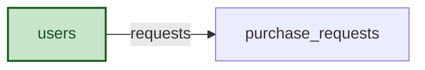

# Demo Purchasing: Semantic Model

## 1. Overview

Demo purchase request tracker (admin-approved).

## 2. Entity summary

| # | Table name | Singular label | Purpose |
|---|---|---|---|
| 1 | `purchase_requests` | Purchase Request | A request to buy something, approved before the order is placed. |
| 2 | `users` | User | Users and agents |

### Entity-relationship diagram



## 3. Entities

### 3.1 `purchase_requests` - Purchase Request

**Plural label:** Purchase Requests
**Label column:** `request_title`
**Audit log:** yes
**View permission:** demo-purchasing:read_purchase_requests
**Edit permission:** demo-purchasing:write_purchase_requests
**Catalog entity code:** `purchase_requests`
**Entity type:** operational_workflow
**Description:** A request to buy something, approved before the order is placed.

**Fields**

| Field name | Format | Required | Label | Description | Reference / Notes |
|---|---|---|---|---|---|
| `request_title` | `string` | yes | Request Title | | `label_column` |
| `workflow_state` | `enum` | yes | Status | | enum_values: `draft`, `submitted`, `approved`, `rejected`; default: "draft" |
| `requester_id` | `reference` | no | Requester | | → `users` (N:1), relationship_label: "requests" |
| `amount` | `number` | no | Amount | Total including tax. | precision: 2 |

**Relationships**

- A `purchase_requests` record may belong to one `users` via `requester_id` (N:1, optional, clear on delete).

**Validation rules**

```json
[
  {
    "code": "99001",
    "name": "approve_needs_gate",
    "message": "Only an admin can approve a purchase request.",
    "description": "Approving is a process gate.",
    "jsonlogic": {
      "if": [
        {
          "and": [
            {
              "value_changed": "workflow_state"
            },
            {
              "==": [
                {
                  "var": "workflow_state"
                },
                "approved"
              ]
            }
          ]
        },
        {
          "has_permission": "demo-purchasing:approve_request"
        },
        true
      ]
    }
  },
  {
    "code": "99002",
    "name": "delete_needs_permission",
    "message": "Only a purchasing admin can delete a purchase request.",
    "description": "Deleting is permission-gated.",
    "jsonlogic": {
      "if": [
        {
          "==": [
            {
              "var": "$mode"
            },
            "delete"
          ]
        },
        {
          "has_permission": "demo-purchasing:delete_requests"
        },
        true
      ]
    }
  },
  {
    "code": "99003",
    "name": "create_needs_gate",
    "message": "Only an admin can create a purchase request.",
    "description": "Creating a request is a process gate.",
    "jsonlogic": {
      "if": [
        {
          "==": [
            {
              "var": "$old"
            },
            null
          ]
        },
        {
          "has_permission": "demo-purchasing:create_request"
        },
        true
      ]
    }
  }
]
```

### 3.2 `users` - User

**Plural label:** Users
**Label column:** `email`
**Reconciliation:** reuse-from semantius_builtin.users
**Description:** Users and agents

**Relationships**

- An `users` record may have many `purchase_requests` (1:N, via `purchase_requests.requester_id`).

---

## 4. Relationship summary

| FK table | FK field | References | Cardinality | Kind | fk_format | Delete behavior |
|---|---|---|---|---|---|---|
| `purchase_requests` | `requester_id` | `users` | N:1 | reference | reference | clear |

## 5. Enumerations

### `purchase_requests.workflow_state`
- `draft`
- `submitted`
- `approved`
- `rejected`

## 6. Cross-model relationship suggestions

_(none: live extraction is reverse-engineering; every cross-module FK already exists as a §3 reference)_

### Outbound handoffs

_(none: not extracted from live state by semantius-optimizer; carried from the blueprint when one exists)_

### Inbound handoffs

_(none: not extracted from live state by semantius-optimizer; carried from the blueprint when one exists)_

## 7. Open questions

### 7.1 🔴 Decisions needed (blockers)

_(none: reverse-engineered from a live module; nothing blocks redeployment)_

### 7.2 🟡 Future considerations (deferred scope)

_(none: reverse-engineered from a live module)_

## 8.1 Permissions catalog

| permission | tier | description | included in `:admin`? | high risk? |
| --- | --- | --- | --- | --- |
| `demo-purchasing:read` | baseline-read | Read access to every record in the module. | ✓ | - |
| `demo-purchasing:manage` | baseline-manage | Create and edit records in the module. | ✓ | - |
| `demo-purchasing:admin` | baseline-admin | Administer reference data and settings. | - | - |
| `demo-purchasing:approve_request` | workflow-gate (lifecycle) | Approve a purchase request. | ✓ | - |
| `demo-purchasing:create_request` | workflow-gate (lifecycle) | Create a purchase request. | ✓ | - |
| `demo-purchasing:delete_requests` | workflow-gate (rule) | Delete purchase requests. | ✓ | - |
| `demo-purchasing:read_purchase_requests` | entity-read | Read Purchase Requests | ✓ | - |
| `demo-purchasing:write_purchase_requests` | entity-write | Write Purchase Requests | ✓ | - |

## 8.2 Business rules

_(none: not extracted from live state by semantius-optimizer; author by hand)_

## 9. Governance

### 9.1 `DEMO-PURCHASING`

**Baseline roles:**

| role | baseline grant | origin | catalog role code | reconciliation |
| --- | --- | --- | --- | --- |
| `demo_purchasing_viewer` | `demo-purchasing:read` | model | | ♻ exists |
| `demo_purchasing_manager` | `demo-purchasing:manage` | model | | ♻ exists |
| `demo_purchasing_admin` | `demo-purchasing:admin` | model | | ♻ exists |

**Permission hierarchy:**

| permission | includes | reconciliation |
| --- | --- | --- |
| `demo-purchasing:admin` | `demo-purchasing:manage` | ♻ exists |
| `demo-purchasing:manage` | `demo-purchasing:read` | ♻ exists |
| `demo-purchasing:admin` | `demo-purchasing:approve_request` | ♻ exists |
| `demo-purchasing:admin` | `demo-purchasing:create_request` | ♻ exists |
| `demo-purchasing:admin` | `demo-purchasing:delete_requests` | ♻ exists |
| `demo-purchasing:read` | `demo-purchasing:read_purchase_requests` | ♻ exists |
| `demo-purchasing:manage` | `demo-purchasing:write_purchase_requests` | ♻ exists |
| `demo-purchasing:write_purchase_requests` | `demo-purchasing:read_purchase_requests` | ♻ exists |

**Processes:** _(none: access_scope is gated, no Processes catalog is authored)_

### 9.2 Functional ownership and default grants

_(none: not extracted from live state by semantius-optimizer; author by hand)_
