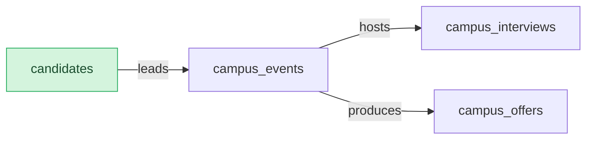

# Campus Hiring: Semantic Model

## 1. Overview

Campus recruiting events.

## 2. Entity summary

| # | Table name | Singular label | Purpose |
|---|---|---|---|
| 1 | `campus_events` | Campus Event | A recruiting event at a university. |
| 2 | `campus_interviews` | Campus Interview | An interview held at a campus event. |
| 3 | `campus_offers` | Campus Offer | An offer made at a campus event. |
| 4 | `campus_scorecards` | Campus Scorecard | A computed summary of a campus event. |
| 5 | `candidates` | Candidate | A person being considered for a job. |

### Entity-relationship diagram



## 3. Entities

### 3.1 `campus_events` - Campus Event

**Plural label:** Campus Events
**Label column:** `event_name`
**Audit log:** yes
**View permission:** campus-hiring:read_campus_events
**Edit permission:** campus-hiring:write_campus_events
**Catalog entity code:** `campus_events`
**Entity type:** operational_workflow
**Description:** A recruiting event at a university.

**Fields**

| Field name | Format | Required | Label | Description | Reference / Notes |
|---|---|---|---|---|---|
| `event_name` | `string` | yes | Event Name | | `label_column` |
| `workflow_state` | `enum` | yes | Status | | enum_values: `planned`, `held`, `written_off`; default: "planned" |
| `candidate_id` | `reference` | no | Lead Candidate | | → `candidates` (N:1), relationship_label: "leads" |

**Relationships**

- A `campus_events` record may belong to one `candidates` via `candidate_id` (N:1, optional, clear on delete).
- A `campus_events` record may have many `campus_interviews` (1:N, via `campus_interviews.campus_event_id`).
- A `campus_events` record may have many `campus_offers` (1:N, via `campus_offers.campus_event_id`).

**Validation rules**

```json
[
  {
    "code": "99001",
    "name": "write_off_needs_gate",
    "message": "Only an admin can write off an event.",
    "description": "Writing off is a process gate whose verb looks like a write permission.",
    "jsonlogic": {
      "if": [
        {
          "and": [
            {
              "value_changed": "workflow_state"
            },
            {
              "==": [
                {
                  "var": "workflow_state"
                },
                "written_off"
              ]
            }
          ]
        },
        {
          "has_permission": "campus-hiring:write_off_event"
        },
        true
      ]
    }
  },
  {
    "code": "99002",
    "name": "delete_needs_permission",
    "message": "Only an offer approver can delete an event.",
    "description": "The only thing that reaches this code is this rule.",
    "jsonlogic": {
      "if": [
        {
          "==": [
            {
              "var": "$mode"
            },
            "delete"
          ]
        },
        {
          "has_permission": "ats-offers:cancel_campus_event"
        },
        true
      ]
    }
  }
]
```

### 3.2 `campus_interviews` - Campus Interview

**Plural label:** Campus Interviews
**Label column:** `interview_title`
**Audit log:** no
**View permission:** campus-hiring:read_campus_interviews
**Edit permission:** campus-hiring:write_campus_interviews
**Catalog entity code:** `campus_interviews`
**Entity type:** operational_record
**Description:** An interview held at a campus event.

**Fields**

| Field name | Format | Required | Label | Description | Reference / Notes |
|---|---|---|---|---|---|
| `interview_title` | `string` | yes | Interview Title | | `label_column` |
| `campus_event_id` | `reference` | yes | Campus Event | | → `campus_events` (N:1), relationship_label: "hosts" |

**Relationships**

- A `campus_interviews` record belongs to one `campus_events` via `campus_event_id` (N:1, required, restrict on delete).

### 3.3 `campus_offers` - Campus Offer

**Plural label:** Campus Offers
**Label column:** `offer_title`
**Audit log:** no
**View permission:** ats-offers:read_campus_offers
**Edit permission:** ats-offers:write_campus_offers
**Catalog entity code:** `campus_offers`
**Entity type:** operational_record
**Catalog owner:** ats-offers
**Description:** An offer made at a campus event. Its permission rows are held by the installed owner.

**Fields**

| Field name | Format | Required | Label | Description | Reference / Notes |
|---|---|---|---|---|---|
| `offer_title` | `string` | yes | Offer Title | | `label_column` |
| `campus_event_id` | `reference` | yes | Campus Event | | → `campus_events` (N:1), relationship_label: "produces" |
| `is_submitted` | `boolean` | no | Submitted | | |

**Relationships**

- A `campus_offers` record belongs to one `campus_events` via `campus_event_id` (N:1, required, restrict on delete).

**Validation rules**

```json
[
  {
    "code": "99003",
    "name": "submitted_offer_is_locked",
    "message": "A submitted offer can only change with the lock override.",
    "description": "Submit-then-lock.",
    "jsonlogic": {
      "if": [
        {
          "var": "$old.is_submitted"
        },
        {
          "require_permission": "ats-offers:bypass_submit_lock"
        },
        true
      ]
    }
  },
  {
    "code": "99004",
    "name": "submit_needs_permission",
    "message": "Only an offer owner can submit an offer.",
    "description": "Submitting is gated.",
    "jsonlogic": {
      "if": [
        {
          "value_changed": "is_submitted"
        },
        {
          "require_permission": "ats-offers:submit_campus_offer"
        },
        true
      ]
    }
  }
]
```

### 3.4 `campus_scorecards` - Campus Scorecard

**Plural label:** Campus Scorecards
**Label column:** `scorecard_name`
**Audit log:** no
**View permission:** campus-hiring:read_campus_scorecards
**Catalog entity code:** `campus_scorecards`
**Entity type:** computed
**Description:** A computed summary of a campus event.

**Fields**

| Field name | Format | Required | Label | Description | Reference / Notes |
|---|---|---|---|---|---|
| `scorecard_name` | `string` | yes | Scorecard Name | | `label_column` |

### 3.5 `candidates` - Candidate

**Plural label:** Candidates
**Label column:** `full_name`
**Reconciliation:** reuse-from hiring-starter.candidates
**Description:** A person being considered for a job. Lives in the first embedder.

**Relationships**

- A `candidates` record may have many `campus_events` (1:N, via `campus_events.candidate_id`).

---

## 4. Relationship summary

| FK table | FK field | References | Cardinality | Kind | fk_format | Delete behavior |
|---|---|---|---|---|---|---|
| `campus_events` | `candidate_id` | `candidates` | N:1 | reference | reference | clear |
| `campus_interviews` | `campus_event_id` | `campus_events` | N:1 | reference | reference | restrict |
| `campus_offers` | `campus_event_id` | `campus_events` | N:1 | reference | reference | restrict |

## 5. Enumerations

### `campus_events.workflow_state`
- `planned`
- `held`
- `written_off`

## 6. Cross-model relationship suggestions

_(none: live extraction is reverse-engineering; every cross-module FK already exists as a §3 reference)_

### Outbound handoffs

_(none: not extracted from live state by semantius-optimizer; carried from the blueprint when one exists)_

### Inbound handoffs

_(none: not extracted from live state by semantius-optimizer; carried from the blueprint when one exists)_

## 7. Open questions

### 7.1 🔴 Decisions needed (blockers)

_(none: reverse-engineered from a live module; nothing blocks redeployment)_

### 7.2 🟡 Future considerations (deferred scope)

_(none: reverse-engineered from a live module)_

## 8.1 Permissions catalog

| permission | tier | description | included in `:admin`? | high risk? |
| --- | --- | --- | --- | --- |
| `campus-hiring:read` | baseline-read | Read access to every record in the module. | ✓ | - |
| `campus-hiring:manage` | baseline-manage | Create and edit records in the module. | ✓ | - |
| `campus-hiring:admin` | baseline-admin | Administer reference data and settings. | - | - |
| `ats-candidate-crm:bypass_submit_lock` | workflow-gate (rule) | Change a submitted candidate record. | ✓ | - |
| `ats-candidate-crm:hire_candidate` | workflow-gate (lifecycle) | Hire a candidate. | ✓ | - |
| `ats-candidate-crm:read_candidates` | entity-read | Read Candidates | ✓ | - |
| `ats-candidate-crm:view_all_candidates` | override | See every candidate, not only your own. | ✓ | - |
| `ats-candidate-crm:write_candidates` | entity-write | Write Candidates | ✓ | - |
| `ats-offers:bypass_submit_lock` | workflow-gate (rule) | Change a submitted offer. | ✓ | - |
| `ats-offers:cancel_campus_event` | workflow-gate (rule) | Cancel a campus event. | - | - |
| `ats-offers:read_campus_offers` | entity-read | Read Campus Offers | ✓ | - |
| `ats-offers:submit_campus_offer` | workflow-gate (rule) | Submit a campus offer. | ✓ | - |
| `ats-offers:write_campus_offers` | entity-write | Write Campus Offers | ✓ | - |
| `campus-hiring:interview` | narrow | Record campus interviews. | ✓ | - |
| `campus-hiring:read_campus_events` | entity-read | Read Campus Events | ✓ | - |
| `campus-hiring:read_campus_interviews` | entity-read | Read Campus Interviews | ✓ | - |
| `campus-hiring:read_campus_scorecards` | entity-read | Read Campus Scorecards | ✓ | - |
| `campus-hiring:write_campus_events` | entity-write | Write Campus Events | ✓ | - |
| `campus-hiring:write_campus_interviews` | entity-write | Write Campus Interviews | ✓ | - |
| `campus-hiring:write_off_event` | workflow-gate (lifecycle) | Write off a campus event. | ✓ | - |
| `lms-skills:read_skill_profiles` | entity-read | Read Skill Profiles | ✓ | - |

## 8.2 Business rules

_(none: not extracted from live state by semantius-optimizer; author by hand)_

## 9. Governance

### 9.1 `CAMPUS-HIRING`

**Baseline roles:**

| role | baseline grant | origin | catalog role code | reconciliation |
| --- | --- | --- | --- | --- |
| `campus_hiring_viewer` | `campus-hiring:read` | model | | ♻ exists |
| `campus_hiring_manager` | `campus-hiring:manage` | model | | ♻ exists |
| `campus_hiring_admin` | `campus-hiring:admin` | model | | ♻ exists |

**Permission hierarchy:**

| permission | includes | reconciliation |
| --- | --- | --- |
| `campus-hiring:admin` | `campus-hiring:manage` | ♻ exists |
| `campus-hiring:manage` | `campus-hiring:read` | ♻ exists |
| `campus-hiring:manage` | `campus-hiring:interview` | ♻ exists |
| `campus-hiring:read` | `campus-hiring:read_campus_events` | ♻ exists |
| `campus-hiring:read` | `campus-hiring:read_campus_interviews` | ♻ exists |
| `campus-hiring:manage` | `campus-hiring:write_campus_events` | ♻ exists |
| `campus-hiring:interview` | `campus-hiring:write_campus_interviews` | ♻ exists |
| `campus-hiring:write_campus_events` | `campus-hiring:read_campus_events` | ♻ exists |
| `campus-hiring:write_campus_interviews` | `campus-hiring:read_campus_interviews` | ♻ exists |
| `campus-hiring:admin` | `campus-hiring:write_off_event` | ♻ exists |
| `campus-hiring:read` | `ats-candidate-crm:read_candidates` | ♻ exists |
| `campus-hiring:manage` | `ats-candidate-crm:write_candidates` | ♻ exists |
| `ats-candidate-crm:write_candidates` | `ats-candidate-crm:read_candidates` | ♻ exists |
| `campus-hiring:admin` | `ats-candidate-crm:hire_candidate` | ♻ exists |
| `campus-hiring:admin` | `ats-candidate-crm:view_all_candidates` | ♻ exists |
| `campus-hiring:read` | `lms-skills:read_skill_profiles` | ♻ exists |
| `campus-hiring:read` | `campus-hiring:read_campus_scorecards` | ♻ exists |
| `campus-hiring:read` | `ats-offers:read_campus_offers` | ♻ exists |
| `campus-hiring:manage` | `ats-offers:write_campus_offers` | ♻ exists |
| `ats-offers:write_campus_offers` | `ats-offers:read_campus_offers` | ♻ exists |
| `campus-hiring:admin` | `ats-offers:bypass_submit_lock` | ♻ exists |
| `campus-hiring:admin` | `ats-offers:submit_campus_offer` | ♻ exists |
| `campus-hiring:admin` | `ats-candidate-crm:bypass_submit_lock` | ♻ exists |

**Processes:** _(none: access_scope is gated, no Processes catalog is authored)_

### 9.2 Functional ownership and default grants

_(none: not extracted from live state by semantius-optimizer; author by hand)_
